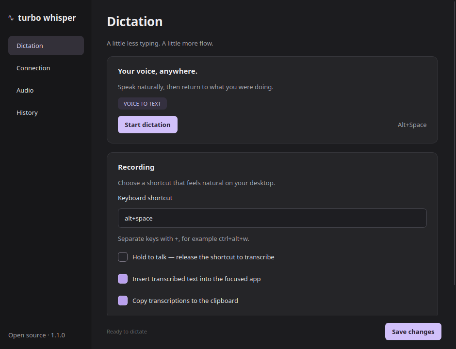
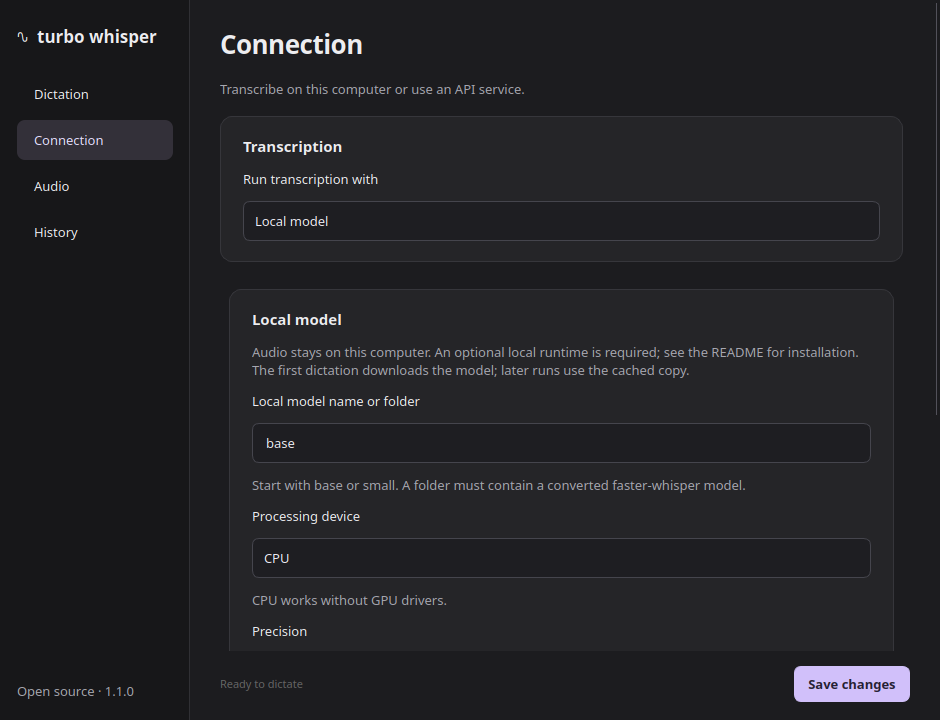

<p align="center">
  <picture>
    <source media="(prefers-color-scheme: dark)" srcset="assets/logo.svg">
    <source media="(prefers-color-scheme: light)" srcset="assets/logo.svg">
    
  </picture>
</p>

[](https://github.com/CameronWeller/turbo-whisper/actions/workflows/ci.yml)

Turbo Whisper is a **free, open source** voice dictation and transcription app for Linux, macOS, and Windows. A SuperWhisper alternative with a beautiful GUI for real-time speech to text (STT). Supports **99 languages** via OpenAI Whisper. Perfect for accessibility, RSI, and hands-free typing.

**Voice dictation** | **Speech to text (STT)** | **Voice typing** | **Transcription** | **Open source** | **Multilingual** | **Hands-free**


[Screencast_20260122_152835.webm](https://github.com/user-attachments/assets/0d53b4d5-377c-49bb-9463-24cdfdc02946)

## Actively maintained fork

This fork, maintained by [Cameron Weller](https://github.com/CameronWeller), is
**actively maintained and improved**, with a focus on Linux desktop reliability,
source builds, and usability. Report issues and propose improvements at
[CameronWeller/turbo-whisper](https://github.com/CameronWeller/turbo-whisper).

Fork maintenance started on 2026-10-29. This initial fork preserves upstream's
application behavior; runtime fixes and improvements will be documented in commits.
The original project is [KnowAll AI's Turbo Whisper](https://github.com/knowall-ai/turbo-whisper).
Its authorship and MIT license are preserved. Upstream's PPA and AUR instructions
below install upstream builds; build this fork from source to use this fork.

## A calmer desktop experience

A compact waveform appears while you dictate. A separate, resizable window keeps
Dictation, Connection, Audio and History easy to find, with a neutral palette and
clear controls inspired by Superwhisper. This remains an independent MIT project.




The [upstream integration ledger](docs/UPSTREAM_PR_INTEGRATION.md) records every
open upstream PR reviewed for this fork, author credit, improvements and validation.

Build the maintained fork:

```bash
git clone https://github.com/CameronWeller/turbo-whisper.git
cd turbo-whisper
# Ubuntu build prerequisite: sudo apt install portaudio19-dev
uv sync --locked --extra dev
uv run turbo-whisper
uv build
```

The launcher opens settings; `turbo-whisper --background` starts in the background.
On GNOME/KDE Wayland, approve the desktop shortcut dialog. Manual recording remains
available when no global shortcut backend is supported. If native text insertion
is unavailable, the app copies the complete result and asks you to paste it.

Turbo Whisper can transcribe on this computer with an optional local runtime, or
send recordings to the API endpoint you configure. It does not bundle model weights.
The separately installed Superwhisper application has its own offline engine.

## Features

- **Global hotkey** (Ctrl+Shift+Space) to start/stop recording from anywhere
- **Waveform visualization** - see your audio levels in real-time with an animated orb
- **OpenAI API compatible** - works with OpenAI Whisper API or self-hosted faster-whisper-server
- **Local models** - run faster-whisper inside the app, with no API key or server
- **Local CPU / GPU inference** - CPU support with optional hardware acceleration
- **Multilingual** - supports 99 languages via Whisper
- **Auto-type** - transcribed text is typed directly into the focused window
- **Clipboard support** - text is also copied to clipboard
- **System tray** - runs quietly in the background with autostart support
- **Cross-platform** - Linux, macOS, and Windows support
- **Accessibility** - great for RSI, carpal tunnel, or anyone preferring hands-free input

## Perfect for AI CLI Tools

Turbo Whisper is ideal for voice input with terminal-based AI tools:

- **[Claude Code](https://github.com/anthropics/claude-code)** - Anthropic's CLI for Claude
- **[Aider](https://github.com/paul-gauthier/aider)** - AI pair programming in your terminal
- **[GitHub Copilot CLI](https://githubnext.com/projects/copilot-cli)** - Voice commands for git and shell
- **[Open Interpreter](https://github.com/OpenInterpreter/open-interpreter)** - Natural language to code execution
- **Any terminal app** - Works anywhere you can type text

Simply press the hotkey, speak your prompt, and the transcription is typed directly into your terminal.

### Claude Code Integration (Experimental)

> **Note:** This feature is experimental and has limitations. See [issue #23](https://github.com/knowall-ai/turbo-whisper/issues/23) for planned improvements.

When dictating into Claude Code, you may want to wait until Claude finishes responding before typing your text. Turbo Whisper has built-in support for this.

**How it works:**
1. Turbo Whisper runs an HTTP server on `localhost:7878`
2. After transcription, it waits up to 2 seconds for a "ready" signal
3. When Claude Code sends the signal, the text is typed

**Setup:**

1. Enable in your config (`~/.config/turbo-whisper/config.json`):
```json
{
  "claude_integration": true,
  "claude_integration_port": 7878
}
```

2. Create a Claude Code hook at `~/.claude/hooks/post-response.sh`:
```bash
#!/bin/bash
# Signal Turbo Whisper that Claude is ready for input
curl -s -X POST http://localhost:7878/ready > /dev/null 2>&1
```

3. Make it executable:
```bash
chmod +x ~/.claude/hooks/post-response.sh
```

4. Configure Claude Code to run the hook (in `~/.claude/settings.json`):
```json
{
  "hooks": {
    "postResponse": ["~/.claude/hooks/post-response.sh"]
  }
}
```

**Without the hook:** If Claude integration is enabled but no ready signal is received within 2 seconds, the text is copied to clipboard only (not typed). You'll see "Copied (Claude busy)" in the tray notification.

**To disable:** Set `"claude_integration": false` in your config for immediate typing without waiting.

## Installation

### Upstream Ubuntu/Debian packages

```bash
sudo add-apt-repository ppa:bengweeks/turbo-whisper
sudo apt update
sudo apt install turbo-whisper
```

### Upstream Arch Linux packages

```bash
# Using yay
yay -S turbo-whisper

# Using paru
paru -S turbo-whisper
```

### From Source

<details>
<summary>Ubuntu/Debian</summary>

```bash
# Install system dependencies
sudo apt install python3-pyaudio portaudio19-dev xdotool xclip

# Clone and install
git clone https://github.com/CameronWeller/turbo-whisper.git
cd turbo-whisper
python3 -m venv .venv
source .venv/bin/activate
pip install -e .
```

</details>

<details>
<summary>Fedora</summary>

```bash
sudo dnf install python3-pyaudio portaudio-devel xdotool xclip
git clone https://github.com/CameronWeller/turbo-whisper.git
cd turbo-whisper
python3 -m venv .venv
source .venv/bin/activate
pip install -e .
```

</details>

<details>
<summary>Arch Linux (manual)</summary>

```bash
sudo pacman -S python-pyaudio portaudio xdotool xclip
git clone https://github.com/CameronWeller/turbo-whisper.git
cd turbo-whisper
python3 -m venv .venv
source .venv/bin/activate
pip install -e .
```

</details>

### macOS

```bash
# Install Homebrew dependencies
brew install portaudio

# Clone and install
git clone https://github.com/CameronWeller/turbo-whisper.git
cd turbo-whisper
python3 -m venv .venv
source .venv/bin/activate
pip install -e .
```

### Windows

```powershell
# Clone the repository
git clone https://github.com/CameronWeller/turbo-whisper.git
cd turbo-whisper

# Create virtual environment
python -m venv .venv
.venv\Scripts\activate

# Install dependencies
pip install -e .
pip install pyperclip  # Required for Windows clipboard/typing
```

## Configuration

Create `~/.config/turbo-whisper/config.json` (Linux/macOS) or `%APPDATA%\turbo-whisper\config.json` (Windows):

```json
{
  "transcription_backend": "api",
  "local_model": "base",
  "local_device": "cpu",
  "local_compute_type": "int8",
  "local_files_only": false,
  "live_transcription": false,
  "whisper_cpp_binary": "whisper-cli",
  "whisper_cpp_model": "",
  "whisper_cpp_device": 0,
  "whisper_cpp_timeout": 120.0,
  "whisper_cpp_use_gpu": false,
  "whisper_cpp_require_gpu": false,
  "api_url": "https://api.openai.com/v1/audio/transcriptions",
  "api_key": "sk-your-api-key",
  "hotkey": ["ctrl", "shift", "space"],
  "push_to_talk": false,
  "language": "en",
  "auto_paste": true,
  "copy_to_clipboard": true,
  "typing_delay_ms": 5,
  "waveform_color": "#00ff88",
  "background_color": "#1a1a2e"
}
```

### API Endpoints

**OpenAI API:**
```json
{
  "api_url": "https://api.openai.com/v1/audio/transcriptions",
  "api_key": "sk-your-api-key"
}
```

**Self-hosted faster-whisper-server:**
```json
{
  "api_url": "http://your-server:8000/v1/audio/transcriptions",
  "api_key": ""
}
```

## Usage

```bash
# Activate virtual environment
source .venv/bin/activate  # Linux/macOS
# or
.venv\Scripts\activate     # Windows

# Start the application
turbo-whisper
```

1. Press your configured hotkey to start recording
2. Speak your text
3. Press the hotkey again to stop and transcribe
4. Text is automatically typed into the focused window (wherever your cursor is)

### Keyboard Shortcuts

| Shortcut | Action |
|----------|--------|
| Configurable hotkey | Start/stop recording |
| Esc | Cancel recording (when window is focused) |

### Custom Hotkey

Edit your config to change the hotkey:
```json
{
  "hotkey": ["ctrl", "alt", "w"],
  "push_to_talk": false
}
```

Available modifiers: `ctrl`, `shift`, `alt`, `super`

Enable hold-to-talk (press and hold to record, release to stop):

```json
{
  "hotkey": ["alt"],
  "push_to_talk": true
}
```

### Autostart on Login

To start Turbo Whisper automatically when you log in:

**Linux (all distros):**
```bash
# Create autostart directory if it doesn't exist
mkdir -p ~/.config/autostart

# Copy the desktop file (if installed via AUR/PPA)
cp /usr/share/applications/turbo-whisper.desktop ~/.config/autostart/

# Or create manually
cat > ~/.config/autostart/turbo-whisper.desktop << 'EOF'
[Desktop Entry]
Name=Turbo Whisper
Exec=turbo-whisper
Type=Application
X-GNOME-Autostart-enabled=true
EOF
```

**macOS:**
- Open System Preferences → Users & Groups → Login Items
- Click + and add Turbo Whisper

**Windows:**
- Press Win+R, type `shell:startup`, press Enter
- Create a shortcut to `turbo-whisper` in that folder

## whisper.cpp local CPU and optional acceleration

Choose **Connection → whisper.cpp (local CPU / GPU)**, set the `whisper-cli`
executable and select an existing whisper.cpp `ggml-*.bin` model. New profiles
use CPU inference and do not require graphics drivers or a dedicated GPU. The
app supports the existing record-then-transcribe and live-phrase workflows on CPU.

For source-checkout use with an existing model:

```bash
TURBO_WHISPER_CPP_MODEL=/path/to/ggml-model.bin ./tools/run-local
```

The launcher creates an ignored `.local-config/config.json` only when absent and
preserves saved settings on subsequent runs. `--configure-only` prepares that
profile without launching. It reuses the installed app runtime when available.
Quit an existing instance before switching profiles. No weights are downloaded.

**Use GPU acceleration when available** is optional. A compatible runtime can
accelerate inference; leave **Require GPU acceleration** off to permit CPU fallback.
Turning GPU use off explicitly selects CPU in both batch and live inference.
The default does not depend on any GPU vendor. The runtime must match your OS:
see the [upstream installation and CPU/GPU options](https://github.com/ggml-org/whisper.cpp).

This targets common 64-bit Windows, Linux and macOS computers. Compatibility does
not imply equal speed across machines. Model memory and compute needs matter:
choose `base` or `small` for a CPU-oriented setup, and evaluate transcription quality
before changing an existing model. Existing model selections are preserved.
Cross-platform tests cover interfaces; native hardware testing remains more limited.
No percentage-of-PC coverage has been measured.

Audio is mono 16 kHz PCM16 WAV. Batch mode uses private temporary files and a
bounded subprocess. Live mode keeps one local worker loaded between sessions.
Existing launcher aliases remain compatible with saved profiles.

## Live local phrases

Enable **Dictation → Insert local phrases as you speak**, together with
**Insert transcribed text into the focused app**. Choose a local backend in
Connection. Pause briefly between phrases: a roughly 0.6-second quiet interval
sends the completed phrase while recording continues. Stopping flushes the rest;
the full combined transcript is saved in History without typing it twice.
Existing configurations keep the original record-then-transcribe behavior.

For whisper.cpp, live mode uses `whisper-server` from the same installed build as
`whisper-cli`. The app owns the worker, binds it only to loopback on a private
route, and keeps the selected model loaded between dictations until quitting.
No external transcription service or new model is used. First use still includes
model startup. The optional faster-whisper backend reuses its in-process model.

Continuous speech with no qualifying pause is retained and transcribed at stop;
this is phrase dictation, so it does not show provisional word-by-word guesses.
Cancel suppresses pending inference results; text already being inserted cannot
be retracted. If insertion fails, further insertion stops and the remaining text
is copied; the full successful transcript remains in History. Inference or capture
failures are shown as errors. Settings can be changed after dictation finishes.

The recording HUD shows actual captured duration once audio arrives. If a long
session produces short text, compare that duration with your speaking time and
use History's copy button for the full transcript (list rows show short previews).
See [measurements and remaining limits](docs/LOCAL_LATENCY.adoc).

## faster-whisper local models (no server)

From this repository, launch with the optional inference runtime:

```bash
uv run --with-requirements requirements-local.txt turbo-whisper
```

Or, in an activated pip virtual environment:

```bash
pip install -e . -r requirements-local.txt
turbo-whisper
```

Open **Connection**, choose **Local model**, and save. Start with model `base`,
device **CPU**, and precision **int8**. The first dictation downloads the model
from Hugging Face, so it can take longer. Following dictations reuse the loaded
model; subsequent launches use the disk cache. For better accuracy, try `small`.
Keep using the launch command above to include the optional runtime when using uv.
The desktop app's existing dependency lockfile remains independent of this runtime;
`requirements-local.txt` pins the engine version, not its transitive dependencies.

Local mode processes recorded audio inside the app and never falls back to an API.
To forbid model downloads, enable **Use downloaded models only** after the model
has been cached, or supply a path to an existing converted faster-whisper model
folder (not a whisper.cpp GGUF file). Leave the language blank for automatic
detection. The API timeout applies only to API requests, not local inference.

Equivalent local configuration:

```json
{
  "transcription_backend": "local",
  "local_model": "base",
  "local_device": "cpu",
  "local_compute_type": "int8",
  "local_files_only": false,
  "language": "en"
}
```

CPU mode works without GPU drivers on common supported desktop platforms. The
faster-whisper GPU option uses CUDA. The whisper.cpp backend supports CPU and the
acceleration options provided by its installed build. See the
[faster-whisper runtime requirements](https://github.com/SYSTRAN/faster-whisper#gpu)
for compatible accelerated installations.
Existing configurations continue to use the API unless you select local mode.



## Self-Hosting Whisper

You can run your own Whisper server for faster, private, and cost-free transcription using [faster-whisper-server](https://github.com/fedirz/faster-whisper-server).

### Hardware Requirements

| Model | VRAM (GPU) | RAM (CPU) | Speed | Accuracy |
|-------|------------|-----------|-------|----------|
| tiny | ~1 GB | ~2 GB | Fastest | Basic |
| base | ~1 GB | ~2 GB | Very fast | Good |
| small | ~2 GB | ~4 GB | Fast | Better |
| medium | ~5 GB | ~8 GB | Moderate | Great |
| large-v3 | ~10 GB | ~16 GB | Slower | Best |

**Recommendations:**
- **GPU with 6+ GB VRAM**: Use `large-v3` for best accuracy
- **GPU with 4 GB VRAM**: Use `small` or `medium`
- **CPU only**: Use `tiny` or `base` (expect slower transcription)

### Quick Start with Docker

```bash
# With NVIDIA GPU (recommended)
docker run --gpus=all -p 8000:8000 \
  -e WHISPER__MODEL=Systran/faster-whisper-large-v3 \
  fedirz/faster-whisper-server:latest-cuda

# With smaller model (less VRAM)
docker run --gpus=all -p 8000:8000 \
  -e WHISPER__MODEL=Systran/faster-whisper-small \
  fedirz/faster-whisper-server:latest-cuda

# CPU only (slower, no GPU required)
docker run -p 8000:8000 \
  -e WHISPER__MODEL=Systran/faster-whisper-base \
  fedirz/faster-whisper-server:latest-cpu
```

### Available Models

Models are downloaded automatically on first use:

| Model ID | Size |
|----------|------|
| `Systran/faster-whisper-tiny` | ~75 MB |
| `Systran/faster-whisper-base` | ~150 MB |
| `Systran/faster-whisper-small` | ~500 MB |
| `Systran/faster-whisper-medium` | ~1.5 GB |
| `Systran/faster-whisper-large-v3` | ~3 GB |

### Persistent Model Cache

To avoid re-downloading models on container restart:

```bash
docker run --gpus=all -p 8000:8000 \
  -v ~/.cache/huggingface:/root/.cache/huggingface \
  -e WHISPER__MODEL=Systran/faster-whisper-large-v3 \
  fedirz/faster-whisper-server:latest-cuda
```

### Configure Turbo Whisper

Update your config to use the self-hosted server:

```json
{
  "api_url": "http://localhost:8000/v1/audio/transcriptions",
  "api_key": ""
}
```

### Verify Server is Running

```bash
curl http://localhost:8000/health
```

## Documentation

For detailed documentation, see the [`docs/`](docs/) directory:

- **[Installation Guide](docs/INSTALLATION.adoc)** - Complete installation instructions for all platforms
- **[Solution Design](docs/SOLUTION_DESIGN.adoc)** - Technical architecture and cross-platform compatibility
- **[Troubleshooting](docs/TROUBLESHOOTING.adoc)** - Common issues and solutions

## Troubleshooting

### Linux: Hotkey conflicts
If Ctrl+Shift+Space conflicts with another application, edit the config:
```json
{
  "hotkey": ["ctrl", "alt", "w"]
}
```

### Windows: PyAudio installation fails
Install the pre-built wheel:
```powershell
pip install pipwin
pipwin install pyaudio
```

### macOS: Accessibility permissions
Grant accessibility permissions to your terminal app in System Preferences → Security & Privacy → Privacy → Accessibility.

For more troubleshooting tips, see [docs/TROUBLESHOOTING.adoc](docs/TROUBLESHOOTING.adoc).

## License

MIT License - see [LICENSE](LICENSE) for details.

## Keywords

Voice dictation Linux, speech to text, STT, voice typing, transcription, transcribe audio, OpenAI Whisper GUI, dictation software, speech recognition, voice input, hands-free typing, accessibility, SuperWhisper alternative, faster-whisper, voice to text CLI, terminal dictation, free open source, multilingual, 99 languages, RSI, carpal tunnel, real-time transcription, local whisper, offline speech recognition, nerd-dictation alternative, voice coding, voice input terminal, how to dictate on Linux, best voice dictation Linux, Ubuntu voice typing, Arch Linux dictation.

## Credits

Inspired by [SuperWhisper](https://superwhisper.com/) for macOS.
